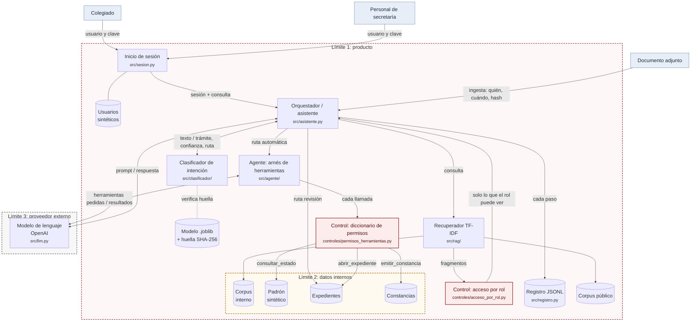

# Arquitectura

Cada límite de confianza es un `subgraph` con borde discontinuo. Los controles (en rojo) se pueden activar o desactivar para medir el producto con y sin ellos.

## Recorrido de una consulta

1. **Inicio de sesión:** fija usuario, rol y código de colegiado. Todo lo demás usa la sesión, nunca lo que el usuario escribe.
2. **Adjunto (opcional):** su texto entra solo al contexto de esta consulta; no se agrega al índice. En el registro queda quién lo subió, cuándo y su huella SHA-256.
3. **Clasificador de intención:** decide el trámite y la ruta. Por debajo de 0,6 de confianza, o si el trámite es sensible, la ruta es **revisión humana**.
4. **Recuperador:** trae los fragmentos más parecidos; el control de acceso por rol quita los internos si quien pregunta es colegiado.
5. **Ruta automática:** el agente conversa con el modelo, que **propone** herramientas; el arnés las pasa por el diccionario de permisos y **decide** si se ejecutan.
   **Ruta revisión:** el código abre un expediente para Secretaría y el modelo redacta la respuesta.
6. **Registro:** una línea por consulta con la clasificación, los fragmentos (entregados y descartados), cada herramienta (pedida, ejecutada o bloqueada y por qué), el adjunto y la respuesta.

## Límites de confianza

| Límite | Qué cruza | Por qué importa |
|---|---|---|
| Usuario → producto | Credenciales y consultas | Aquí se fija la identidad; entrada de la inyección directa y de la evasión del clasificador |
| Documento adjunto → producto | Texto no confiable que llega al contexto del modelo | Entrada de la inyección indirecta (A1) |
| Producto → datos internos | Fragmentos del corpus interno, lecturas del padrón, escritura de constancias y expedientes | Si no se respeta el rol o los permisos, hay fuga o emisión indebida |
| Producto → proveedor del modelo (OpenAI) | Todo el prompt: fragmentos, adjunto y resultados de herramientas | Es un tercero: lo que se envía sale del producto |

## Decisiones de diseño

- **El modelo propone y el código decide.** Los permisos se aplican en el arnés del agente (`controles/permisos_herramientas.py`), fuera del modelo: una inyección puede cambiar lo que el modelo pide, no lo que el arnés permite.
- **Los controles son enchufables.** El recuperador busca en todo el corpus y el agente acepta cualquier llamada; los controles actúan aparte. Así el mismo catálogo se mide con y sin control.
- **El adjunto no persiste.** Al no entrar al índice, una carga maliciosa no afecta a otros usuarios ni a consultas futuras.
- **Ninguna herramienta ejecuta texto del modelo como código** (no hay `eval`).
- **El modelo del clasificador se verifica antes de cargarse:** `joblib` usa `pickle`, que puede ejecutar código al cargar un archivo alterado.
