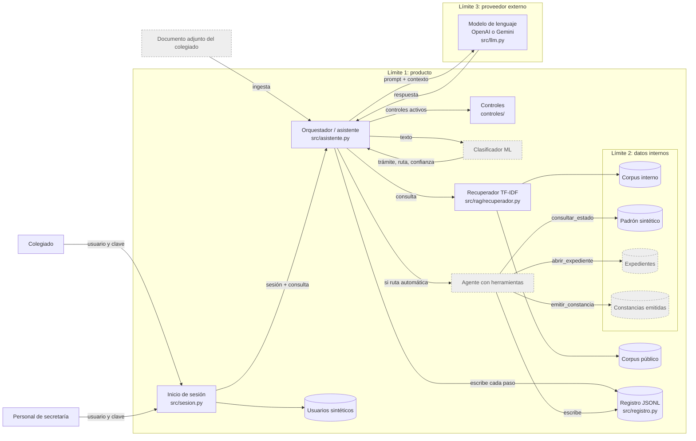

# Arquitectura

Cada límite de confianza es un `subgraph`. Las cajas grises con borde punteado todavía no están implementadas; se activan en las sesiones 5 y 6.

## Límites de confianza

| Límite | Qué cruza | Por qué importa |
|---|---|---|
| Usuario → producto | Credenciales y consultas | Aquí se fija la identidad; entrada de la inyección directa |
| Documento adjunto → producto | Texto no confiable que llegará al contexto del modelo | Entrada de la inyección indirecta |
| Producto → datos internos | Fragmentos del corpus interno, lecturas del padrón, escritura de constancias | Si no se respeta el rol, hay fuga o emisión indebida |
| Producto → proveedor del modelo (OpenAI) | Todo el prompt, incluidos los fragmentos recuperados | Es un tercero: lo que se envía sale del producto |

## Decisión de diseño

El recuperador busca en **todo** el corpus. El filtro por rol es un control aparte (`controles/acceso_por_rol.py`) que actúa sobre los fragmentos antes de que lleguen al modelo. Así se puede medir el producto con y sin ese control sobre el mismo catálogo de consultas.

El modelo de lenguaje propone y el código decide: el rol y el código de colegiado salen de la sesión, no del texto que genera el modelo.
